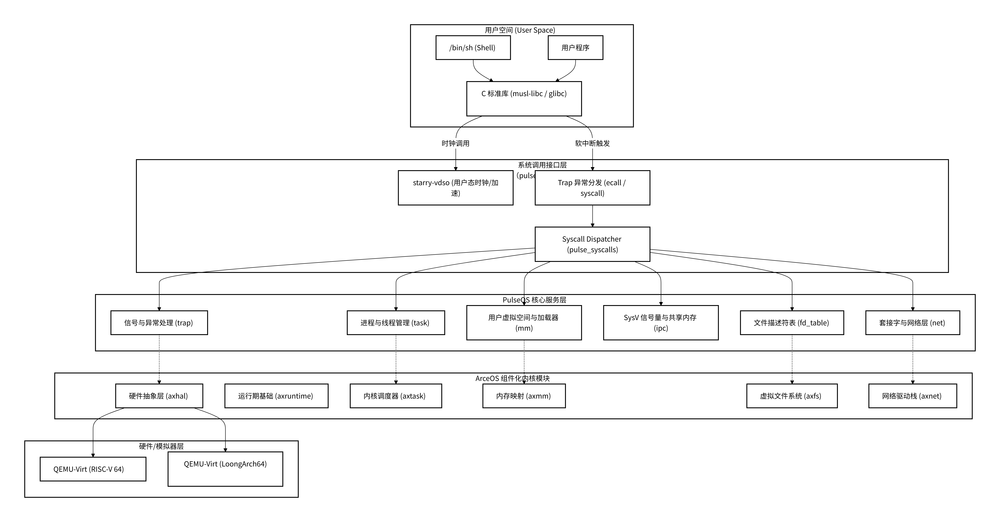

# PulseOS

GitHub 仓库链接: [https://github.com/muou000/PulseOS](https://github.com/muou000/PulseOS)

演示PPT和演示视频见[这里](https://pan.baidu.com/s/1OBeevMPWbBZ45mnfmIVjCA?pwd=XZtN)

PulseOS 是一款基于 [ArceOS](https://github.com/arceos-org/arceos) 组件化内核构建的、支持多架构的组件化宏内核操作系统。PulseOS 针对 RISC-V 64 与 LoongArch 64 双架构进行了深度适配与统一抽象，完整实现了进程管理、文件系统、内存管理、信号系统，以及网络模块，旨在提供尽可能与 Linux 兼容的 POSIX 接口。

## 整体架构

PulseOS 的整体软件栈包含用户空间、Trap 异常分发、内核服务与底层的 ArceOS 组件化基础单元：



---

## 仓库结构

```
.
├── Cargo.toml                 # 根 Workspace 配置
├── Cargo.lock
├── Makefile                   # 统一自包含 Makefile 构建入口
├── scripts                    # 构建支撑与镜像生成脚本
│   ├── make                   # 模块化 Makefile 片段 (cargo.mk, qemu.mk 等)
│   ├── build_img.sh           # 生成 RISC-V 64/LoongArch 64 根文件系统镜像
│   └── fetch-rootfs.sh        # 下载并校验各平台的 rootfs 与测试套件
├── src
│   └── main.rs                # 内核启动与初始用户进程加载
├── api                        # 统一功能特性接口
│   └── axfeat                 # 特性开关与各子系统功能门控
├── configs                    # 内核构建配置 (defconfig.toml 等)
├── modules                    # 摊平的内核核心组件
│   ├── kernel_alloc           # 内存分配器接口
│   ├── config                 # 系统编译期配置与常量生成
│   ├── cpu                    # 架构相关的特权级指令与硬件上下文
│   ├── driver                 # 设备探测、注册与驱动选择
│   ├── driver_*               # 基础、块设备、显示、网络、PCI 和 VirtIO 驱动接口与实现
│   ├── display                # 使用 driver_display 接口的上层显示模块
│   ├── fs                     # 文件系统运行时与挂载
│   ├── vfs                    # 虚拟文件系统抽象层
│   ├── hal                    # 硬件抽象层与页表管理
│   ├── io                     # no_std I/O 抽象库
│   ├── ipi                    # 核间中断处理
│   ├── kernel_log             # 内核日志输出
│   ├── mm                     # 虚存管理与映射
│   ├── net                    # 网络协议栈运行时
│   ├── poll                   # I/O 多路复用与等待队列
│   ├── runtime                # 内核运行时初始化
│   ├── sched                  # 调度器集成层
│   ├── sync                   # 内核同步原语
│   ├── task                   # 内核任务模型与调度
│   ├── bpf                    # BPF 程序、map 和 perf event
│   ├── elf_loader             # 准备 ELF 映像和初始用户栈
│   ├── ipc                    # System V IPC
│   ├── process                # 用户进程、线程、FD、socket、trap 与 io_uring 执行
│   └── io_uring_core          # io_uring 请求与注册资源状态机
├── platforms                  # 硬件平台抽象与具体实现
│   ├── axplat                 # 统一硬件平台抽象接口
│   ├── axplat-riscv64-qemu-virt
│   ├── axplat-riscv64-visionfive2
│   ├── axplat-loongarch64-qemu-virt
│   └── axplat-loongarch64-ls2k1000
├── pulse_syscalls             # Linux 兼容系统调用实现与分派
│   └── src
│       ├── handler.rs         # 系统调用统一入口
│       └── impls              # fs、ipc、mm、net、task、time 等系统调用实现
├── crates                     # 独立外部或演进中的第三方支持库
│   ├── allocator、buddy-slab-allocator # 物理页与堆分配器实现
│   ├── eevdf-scheduler        # 独立 EEVDF 调度算法库
│   ├── ext4plus               # 纯 Rust ext4 文件系统实现
│   ├── smoltcp                # TCP/IP 协议栈
│   ├── virtio-drivers         # VirtIO 底层协议支持
│   ├── memory_*、page_table_* # 地址类型与多架构页表
│   └── starry-vdso            # 用户态 vDSO 支持库
├── rootfs                     # 根文件系统底包缓存（脚本下载，不入库）
├── docs                       # 设计文档、ADR 架构决策与移植记录
└── records                    # 开发日志、性能分析与采样过程产物
```

---

## 内核核心功能实现

- **内存管理 (Memory Management)**:
  - **按需懒分配与写时复制 (COW)**: 采用延迟装载机制，在触发缺页异常时按需分配物理页，并预先映射连续的 3 个页面以减少陷入开销。
  - **TLSF 分配器**: 基于两级分配器架构，通过 TLSF 优化动态内存开销，显著减少内存常驻。
- **进程管理 (Process Management)**:
  - **O(1) 优先级调度**: 采用实时优先级就绪队列，利用位图加速最高优先级查找。
- **文件系统 (Filesystem)**:
  - **多态 VFS**: 抽象出统一的 `FdObject` Trait，无缝对接常规文件、目录、管道、网络套接字等实体。
  - **全 Rust 外部依赖消除**: 选用纯 Rust 的 `ext4plus` 库，避免 C 语言库 FFI 开销与安全缺陷。
- **信号系统 (Signal System)**:
  - **双级信号机制**: 划分进程共享 (`SignalShared`) 与线程局部 (`ThreadSignal`) 信号状态，支持标准 POSIX 信号排队与分发。

---

## PulseOS 优势与亮点

1. **扁平物理页帧元数据管理 (`FrameTable`)**:
   相较于同类系统（如 StarryOS）使用全局锁的 B 树结构，PulseOS 预分配扁平数组 `FrameTable`，实现 O(1) 物理页引用计数查询，且全部基于无锁原子操作更新，极大地消除了并发 `clone` / `fork` 时的锁开销。
2. **安全隔离的用户态拷贝机制**:
   内核不直接解引用用户虚拟地址，而是通过页表翻译后由 `phys_to_virt` 进行内核态物理页的安全拷贝，结合两阶段读写锁与软件缺页懒加载机制，彻底杜绝了内核解引用无效用户地址带来的崩溃隐患。
3. **消除 C 语言依赖的纯 Rust 文件系统**:
   通过使用纯 Rust 实现的 `ext4plus` 库替代 `lwext4` (C 语言库)，消除了跨语言 FFI 性能开销和安全隐患，并且具备良好的异步接口契合度。

---

## 参考项目

本项目在开发和设计过程中参考了以下优秀开源项目：
- **[ArceOS](https://github.com/arceos-org/arceos)**: 核心组件化底座。
- **[StarryOS](https://github.com/os-module/StarryOS)**: 借鉴了部分模块设计。
- **RocketOS**: 借鉴了其批量懒分配的多页映射机制。
- **undefinedOS**: 前期参考了其共享内存多映射设计。
- **[qperf](https://github.com/Starry-OS/qperf)**: 前期使用该 QEMU 插件进行了性能分析与优化（现已完全由内置 BPF 性能采样体系替代并退役）。

---

## 如何开始

### 编译

```bash
make rv        # 编译 RISC-V 64 QEMU 内核
make la        # 编译 LoongArch64 QEMU 内核
make vf2       # 生成 VisionFive 2 的 U-Boot 镜像
make ls2k1000  # 生成 LS2K1000 的启动 ELF
make test      # 编译双架构门禁
make clean     # 清理编译产物
```

BPF 和 pipe 的启动自检默认关闭。测试内核使用
`make test APP_FEATURES="qemu guest-checks"` 显式开启两项检查；
配置组合回归与结果标记见 [guest 自检说明](tests/guest_checks/README.md)。

### 为内核任务保留 CPU

内核在挂载根文件系统、确认在线 CPU 后读取一次 `/etc/pulse-kernel-cpus`。文件缺失或内容为空白时，用户线程可使用全部在线 CPU。要在 8 核机器上保留 CPU 7，在持久化的根文件系统中运行以下命令，再重新启动：

```sh
echo 7 > /etc/pulse-kernel-cpus
```

文件应为最多 4096 字节的普通文本文件。使用调度器的逻辑 CPU 编号，逗号分隔，连续编号可写成闭区间，例如 `2,5-7`。启动日志以十六进制位掩码报告生效集合，例如 `CPU reservation: reserved=0x80 user=0x7f sqpoll=0x0`。编号离线、列表无效或保留了全部在线 CPU 时，启动会在创建首个用户线程前报告错误。

内核任务可以使用保留核。用户线程自首次入队起受用户可用集合约束，在同步系统调用中阻塞或恢复时也遵守该约束。当前线程调用 `sched_setaffinity` 时，只有请求与可用集合的交集生效。交集为空会返回 `EINVAL` 并保留原亲和性。可用 `sched_getaffinity` 查询有效掩码。

要允许应用显式指定 CPU 7 为 ring 的 SQPOLL 服务核，将它同时写入保留集合和服务集合，然后重启：

```sh
echo 7 > /etc/pulse-kernel-cpus
echo 7 > /etc/pulse-sqpoll-cpus
```

`/etc/pulse-sqpoll-cpus` 采用相同的 CPU 列表语法，缺失或空白表示服务集合为空。服务集合必须是在线保留核的子集，配置有误时启动会在 PID 1 前报告错误。应用使用 `IORING_SETUP_SQPOLL | IORING_SETUP_SQ_AFF` 并设置 `sq_thread_cpu=7` 后，该 ring 的轮询线程从第一次取 SQE 起就在 CPU 7 上运行。用户线程仍在自己的有效掩码内运行。对普通非保留 CPU 的 SQPOLL 绑核请求，目标必须在线且位于创建者的有效掩码中。删除或清空两个文件后重启，即可恢复默认配置。

### 准备测试镜像

| 目标 | 制盘命令 | 产物 | 用户态 |
| --- | --- | --- | --- |
| RISC-V QEMU virt | `make img ARCH=riscv64` | `disk.img` | Ubuntu Base 26.10，平台默认启用 RVV（`plat.user-rvv = true`） |
| VisionFive 2 | `make img ARCH=riscv64 RISCV_PLATFORM=visionfive2` | `disk-vf2.img` | **VisionFive 2 使用（RV64GC，无 RVV）**，Ubuntu 24.04.5 LTS（`plat.user-rvv = false`） |
| LoongArch64 QEMU virt | `make img ARCH=loongarch64` | `disk-la.img` | Loongnix-Server 8 |

QEMU virt 的默认启动参数为 `-cpu max`。内核确认所有可调度 hart 均提供 V 后，才向用户态报告并启用 RVV。VisionFive 2 的 U74 核使用 RV64GC。

RISC-V QEMU 测试镜像使用 Ubuntu 官方的 `ubuntu-base-26.10-base-riscv64.tar.gz`。lmbench、LTP、sysbench、UnixBench、fio 和 liburing 测试程序取自 PulseOS 发布的 `rootfs-tests-riscv64.tar.xz`。VisionFive 2 直接使用这份完整的测试包。两份归档均可缓存在 `rootfs/base/`，分别用 `./scripts/fetch-rootfs.sh --arch riscv64` 和 `RISCV_PLATFORM=visionfive2 ./scripts/fetch-rootfs.sh --arch riscv64` 下载并校验。[Ubuntu Base 26.10](https://cdimage.ubuntu.com/ubuntu-base/releases/26.10/release/) · [PulseOS 测试制品及校验和](https://github.com/muou000/PulseOS/releases/tag/rootfs-tests-20261120)

也可从 Release 直接下载已制好的 ext4 测试盘。RISC-V QEMU、LoongArch64 QEMU、VisionFive 2 分别对应 `disk.img.zst`、`disk-la.img.zst`、`disk-vf2.img.zst`。例如在空目录中下载 RISC-V QEMU 测试盘，校验后解压即可用于下方的 QEMU 命令。[测试镜像和 SHA256SUMS](https://github.com/muou000/PulseOS/releases/tag/rootfs-tests-20261125)

```sh
gh release download rootfs-tests-20261125 -R muou000/PulseOS -p disk.img.zst -p SHA256SUMS
sha256sum --ignore-missing -c SHA256SUMS && zstd -d --sparse disk.img.zst -o disk.img
```

### 在来宾里测试网络

| 工作负载 | 镜像内的工具 | 主要观察量 |
| --- | --- | --- |
| TCP / UDP 传输 | `iperf3` 3.22.1 | TCP 收发吞吐，UDP 接收速率、丢包数与抖动 |
| HTTP 静态文件服务 | `darkhttpd` 1.17 | GET 的状态码、正文和字节数 |
| 并发 HTTP 客户端 | `weighttp` 0.5-pulse1 | 成功响应数、每秒请求数、延迟分布、连接复用次数 |

三条命令均在 `/usr/bin`。测试镜像还提供 lmbench 的 `/opt/lmbench/bin/{lat_tcp,lat_udp,lat_connect,bw_tcp}`。常规制盘会下载并校验对应架构的网络工具包。提前运行 `./scripts/fetch-rootfs.sh --tests` 后可离线制盘。要从源代码重建工具包，在安装相应 Linux GNU 交叉工具链的主机运行 `./scripts/build_netbench.sh riscv64` 或 `./scripts/build_netbench.sh loongarch64`，产物位于 `target/netbench/`。[iperf3 用法](https://software.es.net/iperf/invoking.html) · [darkhttpd](https://unix4lyfe.org/darkhttpd/) · [weighttp](https://github.com/lighttpd/weighttp/tree/weighttp-0.5)

在同一个来宾 shell 中运行以下命令即可测 IPv4 回环。iperf3 的 `receiver` 行给出接收端实际结果，添加 `-J` 可保存 JSON。

```sh
iperf3 -4 -s -B 127.0.0.1 >/tmp/iperf3.log 2>&1 & server=$!
sleep 1
iperf3 -4 -c 127.0.0.1 -t 3
iperf3 -4 -c 127.0.0.1 -u -b 1M -l 512 -t 3
kill "$server"
```

PulseOS 尚未实现 `SO_LINGER`。镜像里的 weighttp 在该选项返回 `ENOPROTOOPT` 时使用系统默认的连接关闭行为。下面用两个并发连接请求镜像里的固定页面。检查 `status_codes.2xx` 等于 16、`response_counts.fail` 和 `errs` 都是 0，以及 `traffic.bytes_body` 等于页面字节数的 16 倍，再比较吞吐和延迟。去掉 `-k` 可以测逐请求新建连接的开销。

```sh
darkhttpd /opt/netbench/www --addr 127.0.0.1 --port 8080 --no-listing >/tmp/darkhttpd.log 2>&1 & server=$!
sleep 1
wc -c /opt/netbench/www/index.html
weighttp -q -n 16 -c 2 -k -a 10 http://127.0.0.1:8080/index.html
kill "$server"
```

**测试 VirtIO 网卡路径。** 按下方命令使用 QEMU user 网络时，可在宿主运行 `iperf3 -4 -s -B 127.0.0.1`，再把来宾客户端的目标地址改为 `10.0.2.2`。测试宿主访问来宾 HTTP 时，在 QEMU 的 `-netdev user,id=…` 参数末尾追加 `,hostfwd=tcp:127.0.0.1:18080-:8080`，来宾用 `--addr 0.0.0.0` 启动 darkhttpd，宿主执行 `curl -fsS http://127.0.0.1:18080/index.html` 可检查正文。两条路径都经过 VirtIO 和 QEMU 用户态网络后端。比较内核改动前后的结果时，固定架构、QEMU 参数、网络路径、时长、负载和并发度，多轮记录两端结果。

### 在来宾里测试 RocksDB

上表的测试镜像均预装 RocksDB 9.11.2。`db_bench` 可测数据库读写和压实，`cache_bench` 可单独测块缓存，`ldb` 可检查键值，`sst_dump` 可校验 SST 文件。四条命令均在 `/usr/bin`，对应的 ELF 和运行库位于 `/opt/rocksdb/{bin,lib}`。制盘主机需要 `dpkg-deb`（Debian/Ubuntu 的 `dpkg` 包）。`make img` 会按架构下载并校验固定版本的包，也可以先用 `./scripts/fetch-rootfs.sh --tests` 准备缓存，再离线运行 `./scripts/build_img.sh all`。[包版本及 SHA256](scripts/rocksdb-packages.tsv)

这组命令在根文件系统的 ext4 上创建独立数据库，顺序写入并刷出 SST，再由另一个进程重新打开，报告随机读的命中数、吞吐和延迟分布。来宾的 `/tmp` 是 tmpfs，数据库路径会影响测到的 I/O。

```sh
db=$(mktemp -d /root/rocksdb.XXXXXX)
db_bench --db="$db" --benchmarks=fillseq,flush --num=10000 --value_size=256 --compression_type=none
db_bench --db="$db" --use_existing_db=1 --benchmarks=readrandom --num=10000 --reads=10000 --histogram=1 --compression_type=none
ldb --db="$db" --hex scan --max_keys=1
sst_dump --file="$db" --command=verify
```

比较优化前后的结果时，固定键数、值大小、线程数和压缩方式。`--benchmarks=readwhilewriting` 可用于并发读写，`--benchmarks=compact` 可单独触发手动压实。[RocksDB 基准工具说明](https://github.com/facebook/rocksdb/wiki/Benchmarking-tools)

### 运行测试 (QEMU)

在新检出的仓库根目录运行 `make test` 后，给两种架构的启动文件各建一个链接。下面的 QEMU 命令和来宾测试脚本使用这两个名字。执行 `make clean` 后需重新建立链接。

```sh
ln -s "${PWD##*/}_riscv64-qemu-virt.bin" kernel-rv
ln -s "${PWD##*/}_loongarch64-qemu-virt.elf" kernel-la
```

#### RISC-V 64

```bash
qemu-system-riscv64 -machine virt -cpu max -kernel kernel-rv -m 8G -nographic -smp 8 -bios default -drive file=disk.img,if=none,format=raw,id=x0,snapshot=on -device virtio-blk-device,drive=x0,bus=virtio-mmio-bus.0 -no-reboot -device virtio-net-device,netdev=net -netdev user,id=net -rtc base=utc
```

#### LoongArch64

```bash
qemu-system-loongarch64 -machine virt -kernel kernel-la -m 8G -nographic -smp 8 -drive file=disk-la.img,if=none,format=raw,id=x0,snapshot=on -device virtio-blk-pci,drive=x0 -no-reboot -device virtio-net-pci,netdev=net0 -netdev user,id=net0 -rtc base=utc
```

## 注

对于loongarch64 musl对于cyclictest中进程调度相关syscalls的实现不完整，直接在scripts/build_img.sh中添加了对应的patch修补libc，使其能调用对应syscalls（由ai实现，详见 [records/ai-logs/Coder/2026-05-02-cyclictest-musl-scheduler.md](records/ai-logs/Coder/2026-05-02-cyclictest-musl-scheduler.md)）
