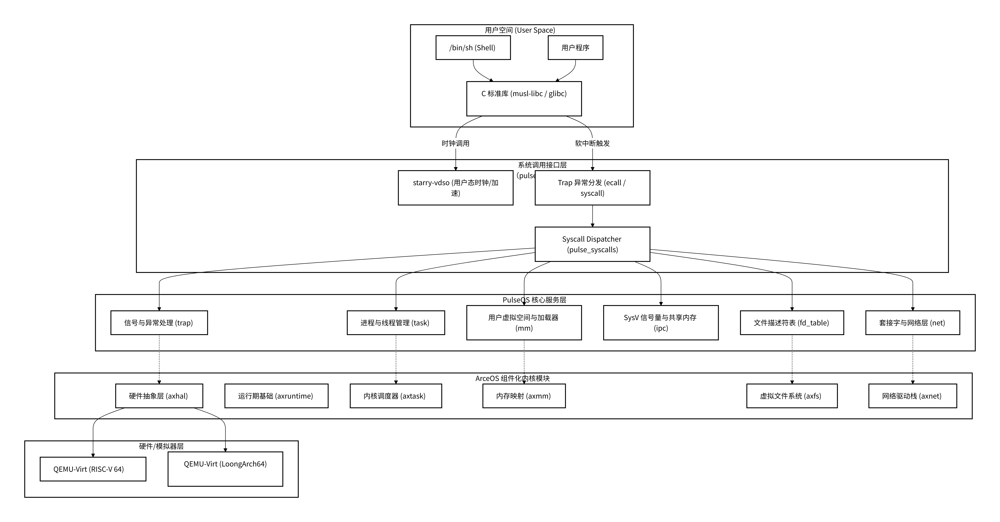

# PulseOS

GitHub 仓库链接: [https://github.com/muou000/PulseOS](https://github.com/muou000/PulseOS)

演示PPT和演示视频见[这里](https://pan.baidu.com/s/1OBeevMPWbBZ45mnfmIVjCA?pwd=XZtN)

PulseOS 是一款基于 [ArceOS](https://github.com/arceos-org/arceos) 组件化内核构建的、支持多架构的组件化宏内核操作系统。PulseOS 针对 RISC-V 64 与 LoongArch 64 双架构进行了深度适配与统一抽象，完整实现了进程管理、文件系统、内存管理、信号系统，以及网络模块，旨在提供尽可能与 Linux 兼容的 POSIX 接口。

## 整体架构

PulseOS 的整体软件栈包含用户空间、Trap 异常分发、内核服务与底层的 ArceOS 组件化基础单元：



---

## 仓库结构

```
.
├── Cargo.toml                 # 根 Workspace 配置
├── Cargo.lock
├── Makefile                   # 统一自包含 Makefile 构建入口
├── scripts                    # 构建支撑与镜像生成脚本
│   ├── make                   # 模块化 Makefile 片段 (cargo.mk, qemu.mk 等)
│   ├── build_img.sh           # 生成 RISC-V 64/LoongArch 64 根文件系统镜像
│   └── fetch-rootfs.sh        # 从 GitHub Release 下载 rootfs 底包并校验
├── src
│   └── main.rs                # 内核启动与初始用户进程加载
├── api                        # 统一功能特性接口
│   └── axfeat                 # 特性开关与各子系统功能门控
├── configs                    # 内核构建配置 (defconfig.toml 等)
├── modules                    # 摊平的内核核心组件
│   ├── axalloc                # 内存分配器接口
│   ├── axconfig               # 系统编译期配置与常量生成
│   ├── axcpu                  # 架构相关的特权级指令与硬件上下文
│   ├── axdriver               # 设备驱动管理层
│   ├── axdriver_*             # 基础、块设备、网络、PCI、VirtIO 驱动模块
│   ├── axfs                   # 文件系统运行时与挂载
│   ├── axfs-ng-vfs            # 虚拟文件系统抽象层
│   ├── axhal                  # 硬件抽象层与页表管理
│   ├── axio                   # no_std I/O 抽象库
│   ├── axipi                  # 核间中断处理
│   ├── axlog                  # 内核日志输出
│   ├── axmm                   # 虚存管理与映射
│   ├── axnet                  # 网络协议栈运行时
│   ├── axpoll                 # I/O 多路复用与等待队列
│   ├── axruntime              # 内核运行时初始化
│   ├── axsched                # 调度器集成层
│   ├── axsync                 # 内核同步原语
│   └── axtask                 # 内核任务模型与调度
├── platforms                  # 硬件平台抽象与具体实现
│   ├── axplat                 # 统一硬件平台抽象接口
│   ├── axplat-riscv64-qemu-virt
│   ├── axplat-riscv64-visionfive2
│   ├── axplat-loongarch64-qemu-virt
│   └── axplat-loongarch64-ls2k1000
├── pulse_core                 # PulseOS 宏内核核心实现
│   └── src
│       ├── fd_table           # 文件描述符表与 FdObject
│       ├── ipc、mm、net、task # 进程/线程管理、内存映射、IPC与网络
│       ├── trap.rs            # 用户态/内核态 Trap 分发
│       └── config.rs、flock.rs、record_lock.rs # 核心辅助模块
├── pulse_syscalls             # Linux 兼容系统调用实现与分派
│   └── src
│       ├── handler.rs         # 系统调用统一入口
│       └── impls              # fs、ipc、mm、net、task、time 等系统调用实现
├── crates                     # 独立外部或演进中的第三方支持库
│   ├── allocator、buddy-slab-allocator # 物理页与堆分配器实现
│   ├── eevdf-scheduler        # 独立 EEVDF 调度算法库
│   ├── ext4plus               # 纯 Rust ext4 文件系统实现
│   ├── smoltcp                # TCP/IP 协议栈
│   ├── virtio-drivers         # VirtIO 底层协议支持
│   ├── memory_*、page_table_* # 地址类型与多架构页表
│   └── starry-vdso            # 用户态 vDSO 支持库
├── rootfs                     # 根文件系统底包缓存（脚本下载，不入库）
├── docs                       # 设计文档、ADR 架构决策与移植记录
└── records                    # 开发日志、性能分析与采样过程产物
```

---

## 内核核心功能实现

- **内存管理 (Memory Management)**:
  - **按需懒分配与写时复制 (COW)**: 采用延迟装载机制，在触发缺页异常时按需分配物理页，并预先映射连续的 3 个页面以减少陷入开销。
  - **TLSF 分配器**: 基于两级分配器架构，通过 TLSF 优化动态内存开销，显著减少内存常驻。
- **进程管理 (Process Management)**:
  - **O(1) 优先级调度**: 采用实时优先级就绪队列，利用位图加速最高优先级查找。
- **文件系统 (Filesystem)**:
  - **多态 VFS**: 抽象出统一的 `FdObject` Trait，无缝对接常规文件、目录、管道、网络套接字等实体。
  - **全 Rust 外部依赖消除**: 选用纯 Rust 的 `ext4plus` 库，避免 C 语言库 FFI 开销与安全缺陷。
- **信号系统 (Signal System)**:
  - **双级信号机制**: 划分进程共享 (`SignalShared`) 与线程局部 (`ThreadSignal`) 信号状态，支持标准 POSIX 信号排队与分发。

---

## PulseOS 优势与亮点

1. **扁平物理页帧元数据管理 (`FrameTable`)**:
   相较于同类系统（如 StarryOS）使用全局锁的 B 树结构，PulseOS 预分配扁平数组 `FrameTable`，实现 O(1) 物理页引用计数查询，且全部基于无锁原子操作更新，极大地消除了并发 `clone` / `fork` 时的锁开销。
2. **安全隔离的用户态拷贝机制**:
   内核不直接解引用用户虚拟地址，而是通过页表翻译后由 `phys_to_virt` 进行内核态物理页的安全拷贝，结合两阶段读写锁与软件缺页懒加载机制，彻底杜绝了内核解引用无效用户地址带来的崩溃隐患。
3. **消除 C 语言依赖的纯 Rust 文件系统**:
   通过使用纯 Rust 实现的 `ext4plus` 库替代 `lwext4` (C 语言库)，消除了跨语言 FFI 性能开销和安全隐患，并且具备良好的异步接口契合度。

---

## 参考项目

本项目在开发和设计过程中参考了以下优秀开源项目：
- **[ArceOS](https://github.com/arceos-org/arceos)**: 核心组件化底座。
- **[StarryOS](https://github.com/os-module/StarryOS)**: 借鉴了部分模块设计。
- **RocketOS**: 借鉴了其批量懒分配的多页映射机制。
- **undefinedOS**: 前期参考了其共享内存多映射设计。
- **[qperf](https://github.com/Starry-OS/qperf)**: 前期使用该 QEMU 插件进行了性能分析与优化（现已完全由内置 BPF 性能采样体系替代并退役）。

---

## 如何开始

### 编译

```bash
make rv        # 编译 RISC-V 64 内核 (kernel-rv)
make la        # 编译 LoongArch64 内核 (kernel-la)
make vf2       # 编译 VisionFive 2 内核 (PulseOS_riscv64-visionfive2.bin)
make ls2k1000  # 编译 LS2K1000 内核 (PulseOS_loongarch64-ls2k1000.bin)
make test      # 编译双架构门禁
make clean     # 清理编译产物
```

### 运行测试 (QEMU)

#### RISC-V 64

```bash
qemu-system-riscv64 -machine virt -kernel kernel-rv -m 8G -nographic -smp 8 -bios default -drive file=disk.img,if=none,format=raw,id=x0,snapshot=on -device virtio-blk-device,drive=x0,bus=virtio-mmio-bus.0 -no-reboot -device virtio-net-device,netdev=net -netdev user,id=net -rtc base=utc
```

#### LoongArch64

```bash
qemu-system-loongarch64 -machine virt -kernel kernel-la -m 8G -nographic -smp 8 -drive file=disk.img,if=none,format=raw,id=x0,snapshot=on -device virtio-blk-pci,drive=x0 -no-reboot -device virtio-net-pci,netdev=net0 -netdev user,id=net0 -rtc base=utc
```

## 注

对于loongarch64 musl对于cyclictest中进程调度相关syscalls的实现不完整，直接在scripts/build_img.sh中添加了对应的patch修补libc，使其能调用对应syscalls（由ai实现，详见 [records/ai-logs/Coder/2026-05-02-cyclictest-musl-scheduler.md](records/ai-logs/Coder/2026-05-02-cyclictest-musl-scheduler.md)）
