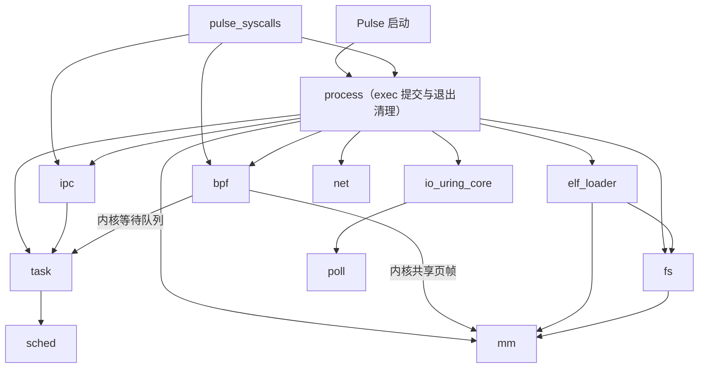

# 按职责命名内核模块，按资源所有权拆分 pulse_core

[ADR-0003](0003-flatten-arceos.md) 合并了内核工作区，暂缓了全局改名。[路线图 #262](https://github.com/muou000/PulseOS/issues/262) 采用下列名字作为目录名、Cargo package 名和仓内 Rust 导入名。进程持有的描述符、地址空间与异步请求由同一层协调释放。下面的消费方与 Cargo 解析结果均取自[迁移基线 a301e8ad](https://github.com/muou000/PulseOS/tree/a301e8ad874b53840b9198e7d888c7a5c50c50bb)。

## 现有模块与机械改名批次

目标列的完整目录是 `modules/<目标>`，package 和 lib crate 均取这个目标名。消费方用基线包名，含可选、目标限定及 dev 依赖。`Pulse` 是启动包。四个仓内平台是两种 QEMU、VisionFive 2 和 LS2K1000。每批改名与职责迁移分开提交，同时更新该批消费方。各批可独立合并，后合并的一批复核共同消费方。

| 旧 Cargo 包 | 目标目录名、Cargo 包名及 Rust crate 名 | 基线直接消费方（含可选依赖与独立测试） | 批次 |
| --- | --- | --- | --- |
| `axalloc` | `kernel_alloc` | `axdriver`、`axfeat`、`axfs`、`axhal`、`axmm`、`axruntime`、`axtask`、`pulse_core`、`pulse_syscalls` | #268 |
| `axconfig` | `config` | `axdriver`、`axfs`、`axhal`、`axipi`、`axmm`、`axruntime`、`axtask`、`pulse_core`、`pulse_syscalls` | #268 |
| `axcpu` | `cpu` | `axhal`、`pulse_core`、`pulse_syscalls`、`axplat-riscv64-qemu-virt`、`axplat-riscv64-visionfive2`、`axplat-loongarch64-qemu-virt`、`axplat-loongarch64-ls2k1000`，以及外部的 `axplat-aarch64-peripherals`、`axplat-aarch64-qemu-virt`、`axplat-x86-pc` | #268 |
| `axhal` | `hal` | `Pulse`、`axdriver`、`axdriver_block`、`axfeat`、`axfs`、`axipi`、`axmm`、`axnet`、`axruntime`、`axtask`、`pulse_core`、`pulse_syscalls` | #268 |
| `axipi` | `ipi` | `axfeat`、`axmm`、`axruntime`、`axtask` | #268 |
| `axlog` | `kernel_log` | `Pulse`、`axdriver`、`axfeat`、`axfs`、`axhal`、`axruntime`、`pulse_core`、`pulse_syscalls`、`axlog` 自身的 dev-dependency | #268 |
| `axruntime` | `runtime` | `Pulse`、`axfeat` | #268 |
| `axsched` | `sched` | `axtask` | #268 |
| `axsync` | `sync` | `Pulse`、`axdisplay`、`axfeat`、`axfs`、`axnet`、`ext4plus`、`pulse_core`、`axsync` 自身的 dev-dependency，以及直接编译互斥锁源码的 `tests/axsync_host` | #268 |
| `axtask` | `task` | `Pulse`、`axdriver`、`axfeat`、`axfs`、`axnet`、`axruntime`、`axsync`、`pulse_core`、`pulse_syscalls`、`axtask` 自身的 dev-dependency，以及用别名提供任务接口的 `tests/axsync_host` | #268 |
| `axmm` | `mm` | `axfs`、`axruntime`、`pulse_core`、`pulse_syscalls` | #269 |
| `axfs` | `fs` | `Pulse`、`axfeat`、`axruntime`、`pulse_core`、`pulse_syscalls`，以及直接编译文件系统源码的 `tests/axfs_io_host`、`tests/axfs_mount_host` | #269 |
| `axfs-ng-vfs` | `vfs` | `axfs`、`pulse_core`、`pulse_syscalls`、`tests/axfs_io_host`、`tests/axfs_mount_host` | #269 |
| `axio` | `io` | `axfs`、`axnet`、`axtask`、`pulse_core`、`pulse_syscalls` | #269 |
| `axpoll` | `poll` | `axdriver`、`axdriver_block`、`axdriver_net`、`axfs`、`axfs-ng-vfs`、`axnet`、`axtask`、`pulse_core`、`pulse_io_uring_core`、`pulse_syscalls`，两个 FS host workspace 还各自 patch 此包 | #269 |
| `axnet` | `net` | `Pulse`、`axfeat`、`axruntime`、`pulse_core`、`pulse_syscalls` | #269 |
| `pulse_io_uring_core` | `io_uring_core` | `pulse_core`、`pulse_syscalls` | #269 |
| `axdriver` | `driver` | `axdisplay`、`axfeat`、`axfs`、`axnet`、`axruntime`，以及用别名提供驱动接口的 `tests/axfs_io_host` | #270 |
| `axdriver_base` | `driver_base` | `axdriver`、`axdriver_block`、`axdriver_display`、`axdriver_net`、`axdriver_virtio` | #270 |
| `axdriver_block` | `driver_block` | `axdriver`、`axdriver_virtio`、`tests/axfs_io_host` | #270 |
| `axdriver_display` | `driver_display` | `axdisplay`、`axdriver`、`axdriver_virtio` | #270 |
| `axdriver_net` | `driver_net` | `axdriver`、`axdriver_virtio`、`axnet` | #270 |
| `axdriver_pci` | `driver_pci` | `axdriver` | #270 |
| `axdriver_virtio` | `driver_virtio` | `axdriver` | #270 |
| `axdisplay` | `display` | `axfeat`、`axruntime` | #270 |

有 11 个包显式指定了 `[lib].name`，分别是 `axcpu`、`axsched`、`axio`、`axpoll`、`axfs-ng-vfs` 和六个 `axdriver_*`。逐一更新库目标或删除多余覆盖，使 Cargo 导出的库名与目标列一致。例如 VFS 的旧 package 是 `axfs-ng-vfs`，Rust 导入是 `axfs_ng_vfs`，两处都迁到 `vfs`。同一作用域若有同名模块，使用绝对 crate 路径或局部导入别名。

`kernel_alloc` 管理内核全局的堆、页和帧引用。Rust 的 `alloc::vec::Vec` 与 `crates/allocator` 提供的分配器后端继续使用各自的名字。`kernel_log` 提供内核输出、初始化和日志级别配置，并使用 crates.io `log` 的 trait 和宏。用真实库源码在临时工作区改这两个 package 名后，下列消费方已通过两种内核 target 的 `cargo check --locked`，同时解析到本地 `allocator 0.1.1` 和 registry `log 0.4.21`。

```rust
#![no_std]
extern crate alloc;

pub fn probe(v: alloc::vec::Vec<u8>, level: log::Level, _: &kernel_alloc::GlobalAllocator)
    -> allocator::AllocResult<usize>
{
    let _: kernel_log::Level = level;
    Ok(v.len())
}
```

## pulse_core 的 12 个入口

此表以[旧 lib.rs](https://github.com/muou000/PulseOS/blob/a301e8ad874b53840b9198e7d888c7a5c50c50bb/pulse_core/src/lib.rs)为索引。新增的 `ipc`、`bpf`、`elf_loader`、`process` 均使用同名的 `modules/` 目录、Cargo 包和 Rust crate。#264 先提取 SysV IPC，#265 与 #266 分别提取 BPF 和装载，#267 归集进程适配。已迁出的接口可以由旧门面临时重导出。#271 将真实入口和 feature 转发切到所有者后移除门面。

| 旧 `pub mod` | 最终所有者与职责 | 当前主要调用方 |
| --- | --- | --- |
| `bpf` | `bpf` 拥有指令、verifier、interpreter、program、map、link、perf event、ring buffer 状态及有界采样队列，主机与内核共用。内核侧使用真实页帧、等待队列和时钟。`process::bpf` 拥有 BPF 对象 FD、映射记录、IRQ 取样和无故障取栈。 | `pulse_syscalls` 的 `validation/bpf_{map,prog,link}.rs` 和 `impls/bpf/{mod,perf_event}.rs` 在主机引用源码。内核侧调用方有 bpf/perf_event_open、mmap、epoll、进程切换映像与映射更新，以及启动时的采样注册。 |
| `config` | `config::user` 拥有用户空间起点和大小、栈顶和大小、堆基址。`config` 保留原 `KERNEL_STACK_SIZE` 常量。 | ELF 装载、进程创建及 exec、uaccess、mmap/shmat 和管道内核检查使用用户布局。本入口的内核栈大小常量在当前树中没有调用方。 |
| `cpu_dma_latency` | `process::fd::cpu_dma_latency` 拥有每次打开的延迟请求及所有生效请求的最小值，随 FD 对象释放请求。 | FD 表识别 `/dev/cpu_dma_latency` 并构造 `CpuDmaLatencyObject`，该对象读出全局生效值，写入本次打开的目标值。 |
| `fd_table` | `process::fd` 拥有共享 FD 表、打开文件描述、`FdObject` 及 pipe、TTY、epoll、signalfd、timerfd 等对象。进程拥有表，部分就绪方法接收进程或线程。 | 进程 fork/exec/close/exit，文件、网络、BPF、io_uring 系统调用与各自的 FD 适配，以及启动时的 TTY 回调注册。 |
| `flock` | `process::fd::flock` 按文件目标和打开对象管理整文件锁及可中断等待。 | `sys_flock`、记录锁对同一目标的分片选择、进程 FD 关闭时的目标查询，以及文件和管道对象的析构。 |
| `io_uring` | `process::io_uring` 拥有内核环 FD、提交者的异步执行上下文快照、SQPOLL、请求执行和 worker。它调用 `task` 的内核多 Future 执行器及 `io_uring_core` 的请求与资源状态机。 | io_uring_setup/enter/register、epoll、进程 exec/exit 的取消入口，以及启动时的环资源内核检查。 |
| `record_lock` | `process::fd::record_lock` 管理 POSIX 和 OFD 字节范围锁，分别跟踪 PID 和打开文件描述的所有权。 | fcntl GETLK/SETLK 系列、close/替换 FD、exec 的 CLOEXEC、进程退出和 `OpenFileDescription::drop`。 |
| `ipc` | `ipc` 拥有 SysV 共享内存附着计数、最后一次解绑后的 IPC_RMID 回收、信号量事务和 SEM_UNDO 记账。进程交接 PID 与 undo 记录，系统调用负责用户 ABI 及 shmdt 解映射失败时回填登记。 | shm*/sem* 系统调用、进程 fork 继承、exec 清理及退出释放资源。 |
| `mm` | `elf_loader` 准备 ELF 主文件、解释器、映射、初始栈与 auxv。`process::uaccess` 拥有依赖进程地址空间的钉住用户缓冲段列表和固定缓冲页，`io_uring_core` 拥有通用固定槽、切片与窗口规则。通用 `copy_from_kernel` 归 `mm`，跨 FS/地址空间的 `lifecycle_checks` 归 `process` 的内核检查。 | `Process::load_elf` 与 `Process::exec` 装载映像。常规文件 I/O 和 io_uring 注册及执行使用钉页。启动入口按 feature 运行映射检查。`copy_from_kernel` 在当前树中没有调用方。 |
| `net` | `process::socket` 拥有实现 `FdObject` 的 socket、Unix socket 路径及就绪适配，下层协议栈由 `net` 提供。 | socket 系统调用中的地址、选项和 I/O 操作，以及 epoll 和 io_uring 的网络操作。 |
| `task` | `process` 拥有用户进程、线程、注册表、信号、计时、uaccess、地址空间句柄与 fork/exec/exit。它通过 `ThreadHandle` 实现 `task` 的任务扩展。`task` 拥有可调度任务、等待唤醒与执行器，`sched` 实现调度策略。 | 启动代码创建首个用户任务、安装 itimer 与 procfs 回调。系统调用、trap、FD、io_uring、BPF 适配读取进程或线程。`pulse_syscalls/tests/sampling_clock.rs` 验证线程采样时钟。 |
| `trap` | `process::trap` 拥有面向用户线程的异常、缺页、返回用户态时的信号递送，以及系统调用使用的 IRQ 守卫。`hal`/`cpu` 提供陷阱分发与体系结构现场。 | 启动调用 `trap::init` 注册页缓存回收。HAL 从注册表分派 USER_RETURN、PAGE_FAULT、ILLEGAL_INSTRUCTION 和 ADDRESS_ERROR。`pulse_syscalls/src/handler.rs` 使用 IRQ 守卫。 |

### 允许的依赖方向

箭头指向被依赖的 crate，图中仅画出此次拆分涉及的主要边。进程关联的 FD、socket、trap 和 io_uring 执行属于 `process` 内部模块。底层需要调用上层实现时，通过已注册的任务扩展、trap 处理函数、TTY/procfs 提供方和 itimer 钩子分发。注册端可以持有具体 Process/Thread，契约端只依赖自身定义的接口。底层 crate 和新子系统禁止反向依赖 `process` 或旧门面。



- **文件映射与 ELF。** `mm` 定义 `FileMappingSource`，`fs` 提供页缓存实现。装载器接受文件系统上下文、凭证值和目标地址空间，准备主程序与解释器。由进程侧向装载器传入构造映射源的函数，`bpf-trace` 打开时为可执行映射附上观测信息。这样 `elf_loader` 可独立于 `process`，通用缺页路径也保持单向。[ADR-0004](0004-axmm-file-mapping-source-boundary.md) · [装载入口](https://github.com/muou000/PulseOS/blob/a301e8ad874b53840b9198e7d888c7a5c50c50bb/pulse_core/src/mm/loader.rs)
- **exec。** `process` 在旧映像仍有效时取得凭证快照，完成路径、解释器、栈与 auxv 等所有可失败的准备。成功后才启动同组线程清退，必要时重绑 TID，停止旧映像的 SQPOLL 并取消关联请求，再替换和激活地址空间。随后完成 vfork、解绑 SHM、清空该进程的 sem undo 记录、处理 CLOEXEC 和记录锁，更新信号与计时器。准备失败时原进程及同组线程可继续运行。[提交顺序](https://github.com/muou000/PulseOS/blob/a301e8ad874b53840b9198e7d888c7a5c50c50bb/pulse_core/src/task/exec.rs#L313-L430)
- **进程退出。** `process` 在释放用户资源前停止该进程的 SQPOLL 并取消关联请求，然后替换旧地址空间、完成 vfork、交给 `ipc` 解绑 SHM 和应用 SEM_UNDO，之后关闭 FD 并清理 futex、锁页额度。先释放该 PID 的 POSIX 记录锁并解绑共享 FD 表，最后持有者才排空描述符，在表锁外析构对象。正在执行的 worker 从异步执行上下文快照取得提交者的地址空间、凭证和 FsContext。独立未链接的 timeout 有自己的存活期。[退出路径](https://github.com/muou000/PulseOS/blob/a301e8ad874b53840b9198e7d888c7a5c50c50bb/pulse_core/src/task/process/runtime.rs#L121-L194) · [ADR-0007](0007-io-uring-hybrid-async-execution-engine.md)

## Cargo 解析基线与迁移门禁

在仓库根目录运行以下命令。`metadata` 给出各包声明的来源、目标条件和解析后的 package ID。`tree` 从启动包按架构及 Make 默认 QEMU/SMP 配置选边，`normal,build` 包含目标库与主机构建依赖。比较时保留项目路径和版本。

```sh
cargo metadata --locked --format-version 1 > /tmp/pulse-metadata.json
cargo metadata --locked --format-version 1 --all-features > /tmp/pulse-all.json
cargo tree --locked -p Pulse --target riscv64gc-unknown-none-elf \
  --features qemu,smp,axfeat/defplat,axfeat/log-level-info,axfeat/bus-mmio -e normal,build
cargo tree --locked -p Pulse --target loongarch64-unknown-none-softfloat \
  --features qemu,smp,axfeat/defplat,axfeat/log-level-info,axfeat/bus-pci -e normal,build
```

| 基线证据 | 结果 | 对迁移的约束 |
| --- | --- | --- |
| 根工作区 metadata | 40 个成员，默认解析 278 个包。全特性 319 个包，其中 52 个 path、266 个 registry、1 个 git。25 个模块各有一个本地 package ID。 | 看 `packages[].source`、`manifest_path`、`targets[].name` 和 `resolve.nodes[].deps[].pkg`，用调用方声明的 `dependencies[].source / req / rename` 解释实际去向。 |
| RV64 QEMU / MMIO | 选中本地 `axplat-riscv64-qemu-virt`，以及 23 个模块，包括本地 CPU 与 VirtIO 块/网络驱动。 | 复查 MMIO feature、驱动类型和页表所在的实现路径。 |
| LA64 QEMU / PCI | 选中本地 `axplat-loongarch64-qemu-virt`，同样选中 23 个模块，使用 PCI 总线。 | 复查 PCI feature、本地驱动和 MSI-X 路径。两棵默认树均未启用 axdisplay 和 axdriver_display，两边加 `axfeat/display` 后均选中全部 25 个本地模块。 |
| 外部及保留身份的包 | 两棵树中的 `axerrno`、`axconfig-macros`、`axconfig-gen`、`axplat-macros`、`ax-kspin`、`ax-kernel-guard`、`ax-crate-interface` 来自 registry。全特性图还包含 git 的 `bcm2835-sdhci`。 | 保留这些包的发布名。仓内 `platforms/axplat`、四个平台包、`api/axfeat` 也保留各自的身份。改的是它们指向模块的边。 |

### 旧名请求与 patch

根 manifest 同时指定 registry 和若干 git URL 的 patch。在全特性元数据中，存在 patch 条目、存在 path 包、以及有消费者按旧名向上游源请求是三种不同事实。按请求源决定处理方式。[基线清单](https://github.com/muou000/PulseOS/blob/a301e8ad874b53840b9198e7d888c7a5c50c50bb/Cargo.toml) · [Cargo 的 patch 规则](https://doc.rust-lang.org/cargo/reference/overriding-dependencies.html#the-patch-section)

| 请求与基线解析 | 本批动作 |
| --- | --- |
| registry `axcpu ^0.2` → `modules/axcpu 0.2.2`。四个仓内平台按版本请求。全图另有 registry 的 `axplat-aarch64-peripherals`、`axplat-aarch64-qemu-virt`、`axplat-x86-pc` 请求同一旧名。 | #268 让可改的平台、hal 等消费者直接依赖本地 `cpu`。为仍请求旧名的外部包，在 `crates/compat/axcpu` 放一个 `no_std` 的同名兼容包，保留 0.2.2，由根 `[patch.crates-io]` 指向它。兼容包以 `default-features = false` 依赖本地 `modules/cpu` 并通过 `pub use cpu::*;` 重导出，逐项转发 default、fp-simd、tls、uspace、arm-el2、ls2k1000，只编译一份实现。旧名兼容包与实际实现具有不同的 package ID。 |
| registry `axpoll ^0.3` → `modules/axpoll 0.3.9`。请求方为 `axdriver_net` 和 `axfs-ng-vfs`。 | 两个请求方都可修改。#269 将二者直接接至本地 `poll`，同时处理两个 FS host 根清单中的 patch。不论 #270 先后顺序，均须按当前目录修改网络驱动对 poll 的依赖。 |
| registry 补丁还有 `axsched`、`axfs-ng-vfs`、`axio`、`axdriver_base`、`axdriver_display`。git `https://github.com/arceos-org/axdriver_crates.git` 补丁列出六个 `axdriver_*`。基线全图对这些模块的消费边是本地路径，没有对相应被补源的请求。 | 在所属批次切完本地调用方，再移除失去用途的旧 patch。跨包传递的驱动 trait、poll 与 VFS 类型必须来自同一实现。 |
| git 的 `allocator` 和 `smoltcp` 请求由各自 URL 的 patch 选中 `crates/allocator` 和 `crates/smoltcp`。内存、页表、VirtIO、板级辅助库和平台接口也有指向仓内源码的 registry patch。 | 保留这些包及其来源覆盖，核对目标树中的本地路径。 |

每批同步更新根成员、workspace.dependencies、target/dev/build 依赖、独立清单与锁文件。消费方可以用 `package = "..."` 指定其依赖的真实包名，但外部包已发布的旧名请求仍按原包名、版本和来源解析。只改 patch 的键无法让 `cpu` 满足 `axcpu ^0.2`。[Cargo 的依赖别名](https://doc.rust-lang.org/cargo/reference/specifying-dependencies.html#renaming-dependencies-in-cargotoml)

重新生成相关锁文件后，用上述锁定命令重跑。沿 `Pulse` 的两棵实际树按表查模块的唯一实现 ID 和本地 manifest 路径，用相同参数加 `-e features` 查 feature 转发、加 `-d` 查重复版本。另查全特性 metadata 的旧名反向边，只允许明确记录的兼容包，并沿其依赖确认最终指向同一实现。锁中无 `[[patch.unused]]` 或 Cargo 没有警告，都不能代替检查调用方和来源。

### 独立工作区、构建和历史记录

- **Feature 与链接。** 同批改根包、`api/axfeat` 和各模块中的依赖键、`dep:包`、`包/feature`、`包?/feature`，保留用户选择的 `alloc-slab`、`sched-eevdf`、`fs`、`net`、`display`、总线和板级驱动等开关。特别检查同名 feature 与可选依赖（例如 `fs` 显式使用 `dep:fs`），避免自引用或意外启用。将旧门面的 `bpf-trace`、`guest-checks`、`mapping-lifecycle-test`、`file-io-test` 和 `ls2k1000` 转发到实际实现。`scripts/make/cargo.mk` 的 `-p` / `--exclude` 和 rustdoc 名单要跟包名更新。任务扩展的弱符号、extern 声明和 `def_task_ext!` 生成的强符号须一致，保留启动注册和链接行为。
- **主机工作区。** 根 `[patch]` 的解析范围止于当前 workspace。逐个运行 `cargo metadata --locked --manifest-path <目录>/Cargo.toml --format-version 1`。在 `tests/axfs_io_host`、`tests/axfs_mount_host` 更新 VFS、poll patch、I/O 测试的块驱动依赖和各自的 Cargo.lock，并修正 `#[path]` 的 FS 源码路径，分别运行 `cargo test --locked --manifest-path …`。#270 同步修改 `tests/axfs_io_host/tests/fat_disk.rs` 的 `extern crate self as axdriver` 和 prelude 导入，并复跑该工作区测试。这样测试内嵌的 FAT 源码也能解析到 `driver::prelude`。`tests/axsync_host` 的 `extern crate self as axtask` 和 mutex 源码路径随 #268 更新，按其 README 运行 `cargo run --locked --manifest-path tests/axsync_host/Cargo.toml`。三个清单在基线均可独立锁定解析。
- **共享实现的测试。** #265 让 BPF host validation 和生产配置通过 Cargo 使用同一份 `bpf` 状态机，去掉跨 crate 的源码 `#[path]`。#267 迁移线程采样时钟的 host 测试。#268/#269 将原 task、sync、VFS 和 io_uring 状态机的 host 命令切到新 `-p` 名称。两种 QEMU 的 `make test` 构建、启用 `bpf-trace` 的构建和相应 guest 行为分别记录，板级依赖另跑 `make vf2`、`make ls2k1000`。
- **平台、工具和证据。** 保留平台包名、Rust 平台入口及 `[package.metadata.axplat]`、平台配置中供 Make 匹配的 package/platform、`cargo axplat`、`axconfig-gen` 和 `AX_CONFIG_PATH`。保持用户 ABI、BPF schema、外部 CLI 及许可证署名。更新仍用于当前树的构建来源清单 `scripts/build_provenance.py` 及其测试、`tests/pcp_boot/run.py` 的 panic 路径、当前开发文档和其中仍要求应用的补丁。基线 `git apply --check` 可应用 `tests/io_uring/worker-scheduler.patch`，而 `tests/kernel_cpus/switch-counts.patch` 已在 `pulse_core/src/task/thread.rs` 失配。#268 更新调度测试补丁时需修复该处，#271 对最终树复查。已归档的采样符号、构建 ID、原始提交链接以及仅在旧提交上回放的补丁保留原身份。
