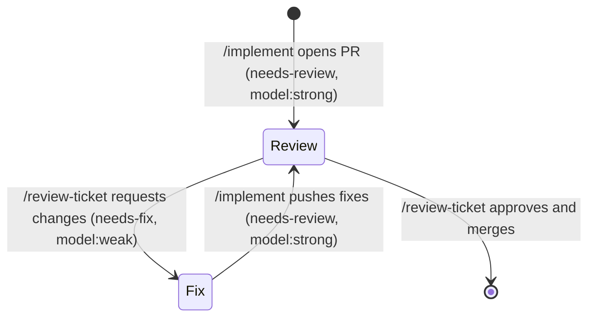

# Ticket workflow: tiers, ticket shape, escalation

The shared reference for `/to-tickets`, `/implement`, `/review-ticket` and `/replan`. Every session is opened by hand, with a model chosen by hand, possibly by a different developer in a different tool. So everything a session needs lives on the tracker: the parent spec, the ticket, its PR, and their comments. Never rely on another session's memory.

GitHub commands for every operation named here live in [issue-tracker.md](issue-tracker.md); label strings live in [triage-labels.md](triage-labels.md).

## Tiers

Two **tiers**, carried as a label on every ticket and PR so a developer filters the frontier by tier and opens the matching model:

| Tier | Label | Work |
| --- | --- | --- |
| strong | `model:strong` | `/grill-with-docs`, `/to-spec`, `/to-tickets`, `/review-ticket` on every PR, `/replan` on every escalation ticket |
| weak | `model:weak` | `/implement` on implementation tickets and `needs-fix` PRs, including the drift check |

A session only does work of its own tier. Work that needs the other tier is handed over through a label or an escalation ticket, never done in place.

## Ticket shape

Every implementation ticket is a GitHub issue, a sub-issue of its parent spec, labelled `model:weak` and `ready-for-agent`, with blockers set as native dependencies. Body:

```markdown
## Parent

#<spec issue>

## What to build

The end-to-end behaviour this ticket makes work, from the user's perspective.

## Implementation plan

1. <step>: <what changes, named by crate/module and symbol> — verify: <command or testcase>
2. ...

## Anchors

- A1: <a fact about the code this plan depends on, checkable by reading the code>
- A2: ...

## Acceptance criteria

- [ ] Criterion 1
- [ ] Criterion 2
```

### Implementation plan: symbol-level

Precise enough that a weak model follows it without design work; coarse enough that local edits elsewhere don't invalidate it.

- **Write**: crate or module paths (`pulse_syscalls` fd module), names of types, functions, traits and syscalls, public interface signatures, ordered steps, and the verification for each step (build and QEMU commands from `AGENTS.md`, named testcases).
- **Leave to the implementer**: line numbers, function bodies, private helpers, test code.
- Open with the failing test the slice starts from; `/implement` drives `/tdd` from it.

### Anchors

Each **anchor** is one checkable fact the plan rests on: an existing signature, a type's ownership model, a symbol an earlier ticket introduces ("`FdTable::get` returns `Arc<File>`", "#12 adds `VfsNode::truncate(&self, len: u64)`"). The plan uses only facts listed as anchors, so checking anchors is checking the plan. Anchors are numbered per ticket so escalations can cite them (`#14 A2`).

## Drift check

Run by the weak session after its PR is open, against the PR branch's code.

1. List every **open** sub-issue of the same parent spec, other than this ticket.
2. For each, read its Anchors. Mark an anchor **broken** when this PR's code contradicts it: a renamed or re-typed symbol, a changed signature, a moved module, a promised symbol introduced in a different shape, or not at all.
3. Broken anchors → one `needs-replan` escalation ticket covering all of them, blocking every affected ticket.
4. Comment on the PR: the tickets and anchor count checked, and the escalation ticket opened (or "no drift").

Judge only anchors. A plan you would have written differently is not drift.

## Escalation tickets

Two kinds, both labelled `model:strong`, created as sub-issues of the same parent spec, and set as a native **blocker** of every affected ticket, so the frontier skips those tickets until the escalation closes:

| Label | Raised when | Blocks |
| --- | --- | --- |
| `needs-replan` | an anchor or plan step of a ticket no longer matches the code (drift check, review, or the implementer finding its own anchors broken) | each affected ticket |
| `needs-strong` | the implementer can't complete a plan step, or the same verification stays red after 3 attempts | the ticket being implemented |

Body:

```markdown
## Parent

#<spec issue>

## Affected tickets

- #<n>: A<k> (or "plan step <k>")

## Evidence

Per affected anchor or step: what the ticket says, what the code says (symbol, module, branch or commit), and the PR or ticket that changed it.

## Work in progress

Branch and PR of the interrupted work, if any (`needs-strong` only).
```

Raising an escalation ends that work in the raising session: push any WIP branch first, then stop. Only `/replan` edits a ticket's plan or anchors, and only `/replan` closes an escalation ticket.

## PR lifecycle

Every ticket's PR targets `main` and links its ticket with `Closes #<n>`, so merging closes the ticket. Labels drive the hand-off:



